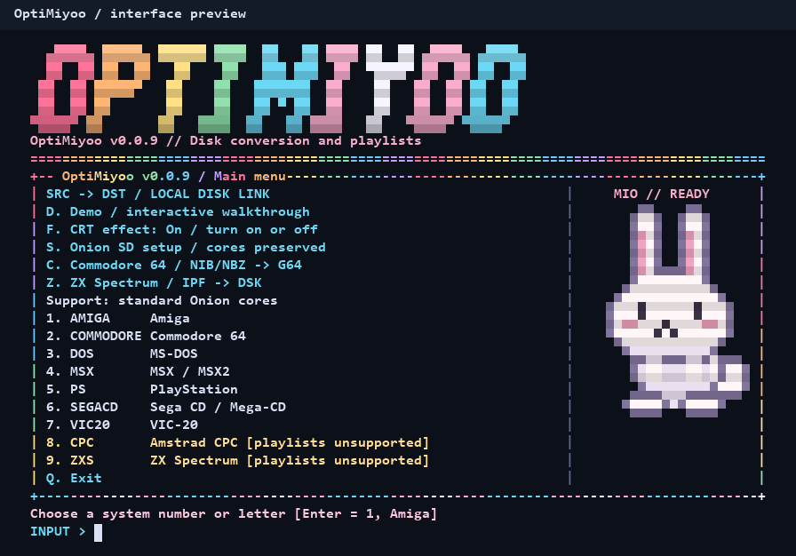

# OptiMiyoo

Create multi-disc playlists or convert disk images for **Onion OS on Miyoo Mini Plus**.

[**Download for Windows**](https://github.com/OptiBunny/OptiMiyoo/archive/refs/heads/main.zip)
· [**User guide**](docs/USAGE.md)

## Quick start

**Windows 10 (1809+) / 11 · x64 · Windows PowerShell 5.1**

1. Download and extract the ZIP to a writable folder.
2. Copy one system's games into the app's `SRC` folder. See
   [how to prepare your games](docs/USAGE.md#prepare-a-batch).
3. Run **`OptiMiyoo.bat`**. Choose a **numbered system** for playlists,
   **C** for C64 conversion, or **Z** for ZX Spectrum conversion.
   Originals are kept by default.
4. Copy the contents of `DST`, including `.hidden` when present, to the matching
   [Onion ROM folder](docs/USAGE.md#systems-and-rom-folders) on your SD card,
   then refresh the game list.

Choose **D** for a demo showcasing the menus, animations, and main features without
changing game files.

## Credits and disclosure

Converter tools are included; ROMs, BIOS files, and Onion cores are not.

AI disclosure: OptiMiyoo is almost entirely vibe-coded. Most of the project’s own code, tests, and documentation were generated and revised by AI. Use it at your own risk.

Bundled third-party tools have their own authors and licenses.

[NIBTools](https://github.com/rittwage/nibtools) ·
[HxC Floppy Emulator](https://github.com/jfdelnero/HxCFloppyEmulator) ·
[CAPSIMG](https://github.com/FrodeSolheim/capsimg) ·
[GCC / MinGW-w64 runtimes from MSYS2](https://github.com/msys2/MINGW-packages)

CAPSIMG's included license restricts commercial use.
See [third-party licenses and source details](third_party/README.md).
